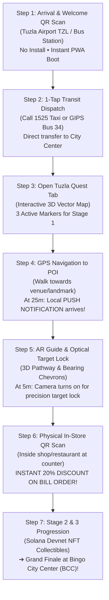

# Tuzla Tour Quest Game — Official Player & Partner Manual 🇧🇦

## Tuzla Tour Potraga — Zvanični Vodič za Igrače i Privredne Partnere

**Version:** 3.0  
**Effective Date:** November 2026  
**Game Architect:** AISO Tuzla & Tuzla Tour Guide Engineering Team  
**Difficulty:** Easy to Medium  
**Platform:** Progressive Web App (PWA) & Hybrid Android (Capacitor)  
**Estimated Completion Time:** 2–3 hours (Self-paced, multi-day support)

---

## 📑 TABLE OF CONTENTS

1. [Executive Summary & The "Guaranteed Footprint" Philosophy](#1-executive-summary--the-guaranteed-footprint-philosophy)
2. [End-to-End Visual Tourist Journey (The 7 Steps)](#2-end-to-end-visual-tourist-journey-the-7-steps)
3. [Benefits for Local Businesses, Gastronomy & Retail](#3-benefits-for-local-businesses-gastronomy--retail)
4. [Tuzla Quest Phases & Reward Architecture](#4-tuzla-quest-phases--reward-architecture)
   - [Phase 1: Foundations of Tuzla](#phase-1-foundations-of-tuzla)
   - [Phase 2: Cultural Heritage, Gastronomy & Solana NFT](#phase-2-cultural-heritage-gastronomy--solana-nft)
   - [Phase 3: Pannonian Lakes, Waterfalls & Fine Arts](#phase-3-pannonian-lakes-waterfalls--fine-arts)
   - [Grand Finale: Premier Anchor Partner (Bingo City Center)](#grand-finale-premier-anchor-partner-bingo-city-center)
5. [Precision Geofencing & AR Camera Engine (25m & 5m Triggers)](#5-precision-geofencing--ar-camera-engine-25m--5m-triggers)
6. [In-Store QR Code Scan & Anti-Fraud Verification](#6-in-store-qr-code-scan--anti-fraud-verification)
7. [Player HUD & Augmented Reality Interface](#7-player-hud--augmented-reality-interface)
8. [Web3 Solana Devnet Wallet & Rewards Collection](#8-web3-solana-devnet-wallet--rewards-collection)
9. [Battery Saver & Hardware Power Profiles](#9-battery-saver--hardware-power-profiles)
10. [Frequently Asked Questions (FAQ) for Players & Merchants](#10-frequently-asked-questions-faq-for-players--merchants)

---

# 1. EXECUTIVE SUMMARY & THE "GUARANTEED FOOTPRINT" PHILOSOPHY

### 🎯 The Challenge of Traditional Tourism Marketing

For decades, cities and local merchants have relied on billboards, print flyers, social media ads, and travel portals (Google Ads, Facebook, TripAdvisor). These channels suffer from a fatal flaw: **they only sell impressions and clicks**. A tourist may tap an Instagram ad at the airport and never step foot into the local crêperie, traditional ćevabdžinica, or artisan craft shop downtown. Furthermore, discount vouchers shared online are easily exploited remotely or forgotten.

### 💡 The Solution: Tuzla Tour Quest & Verified Proof-of-Footprint

**Tuzla Tour Quest** transforms the entire city of Tuzla into an interactive, gamified 3D treasure hunt powered by **Augmented Reality (AR)**, **sub-meter sensor fusion**, and **in-venue physical verification**.

```
   ┌────────────────────────────────────────────────────────────────────────┐
   │                    THE PROOF-OF-FOOTPRINT ADVANTAGE                    │
   ├───────────────────────────────┬────────────────────────────────────────┤
   │ Traditional Digital Ads       │ Tuzla Tour Quest Platform              │
   ├───────────────────────────────┼────────────────────────────────────────┤
   │ ❌ Sells views and impressions│ ✅ Guarantees physical human footfall  │
   │ ❌ Disconnected from location │ ✅ Dynamic 25m push & 5m AR guidance   │
   │ ❌ High remote voucher fraud  │ ✅ Cryptographic physical QR scan      │
   │ ❌ Passive browsing           │ ✅ Active gamified consumer mission    │
   │ ❌ High advertising burn rate │ ✅ Direct in-store sales conversion    │
   │ ❌ Intrusive tracking cookies │ ✅ 100% Privacy by Design (Client-side)│
   └───────────────────────────────┴────────────────────────────────────────┘
```

> **The Footprint Guarantee:** ONLY through the Tuzla Tour App can a participating restaurant, coffee shop, hotel, or retail boutique be 100% guaranteed that potential customers are guided directly from their point of arrival into the physical venue, standing at the counter or cash register with wallet in hand to redeem their verified 20% discount.

---

# 2. END-TO-END VISUAL TOURIST JOURNEY (THE 7 STEPS)

Here is the exact operational sequence that guides a newly arrived tourist from the transit terminal directly into local partner businesses and cultural landmarks:



### 📋 Detailed Step-by-Step Walkthrough

#### 🛫 Step 1: Airport or Bus Terminal QR Scan (Frictionless Onboarding)

- **Location:** Tuzla International Airport (Dubrave / TZL) arrival hall luggage carousel, customs exit, or Tuzla Central Bus Station.
- **Action:** The arriving traveler sees high-visibility official Tuzla Tour Guide posters featuring a large QR code: *"Discover Tuzla in 3D & AR — Win Discounts & Real Rewards!"*
- **The Experience:** The user scans the QR with their default phone camera. Because Tuzla Tour Guide is a Progressive Web App (PWA), **it loads instantaneously in under 1.5 seconds without forcing an App Store or Google Play download**.
- **Result:** Zero barrier to entry; user is immediately equipped with maps, offline guides, and active quest missions.

#### 🚖 Step 2: 1-Tap Integrated Transit Dispatch

- **Location:** Terminal exit / pick-up bay.
- **Action:** User taps the **Transit & Logistics** shortcut inside the app.
- **The Experience:** Direct 1-tap call to licensed Tuzla Taxi Dispatch (`1525 Taxi`) or real-time timetable for GIPS Airport Bus Line 34.
- **Result:** Stress-free transit directly into Tuzla town center (Trg Slobode / Central zone) without language barriers or overpricing.

#### 🗺️ Step 3: Open Tuzla Quest Tab (3D Map & Active Markers)

- **Location:** Tuzla Pedestrian Zone / City Center.
- **Action:** User switches to the **Tuzla Quest** tab.
- **The Experience:** The app presents a 3D vector map rendered via MapLibre GL with a 45° tilt and live compass bearing. Stage 1 markers pulse in vivid emerald green (`#10b981`), clearly distinguishing undiscovered targets from already completed sites (rendered in discreet monochrome).
- **Result:** Clear, gamified goals established; user begins walking towards the nearest marker.

#### 🔔 Step 4: GPS Navigation & The 25-Meter Proximity Alert

- **Location:** Within walking perimeter of the target.
- **Action:** User walks along the suggested pedestrian route.
- **The Experience:** When the device's filtered GPS (`AdaptiveLowPassFilter`) detects the user is **within 25 meters** of the Point of Interest (POI) or local partner shop, the operating system triggers a high-priority local push notification:
  > **🔔 You are 25 meters away!**  
  > *"You have reached the destination zone. Tap here to open the AR Guide and claim your reward!"*
- **Result:** Seamless transition from map browsing to immediate physical engagement.

#### 📷 Step 5: AR Guide Pathway & The 5-Meter Optical Precision Lock

- **Location:** Street front / entrance of the establishment.
- **Action:** User taps the notification or opens AR Guide.
- **The Experience:**
  - **Over 5m away:** The screen presents a split 40/60 view. Top 40% shows 3D bird's-eye walking trajectory; bottom 60% shows directional HUD chevrons (`45° LEFT`, `90° RIGHT`, `ON PATH`).
  - **At 5m away:** The system automatically switches on the **optical camera sensor**. The AR HUD displays a dynamic green reticle: `"TARGET LOCKED"`. An animated directional 3D arrow points directly through the glass doors to the cashier or information counter.
- **Result:** The user is guided with sub-meter precision directly into the physical premises of the local business partner.

#### 🏷️ Step 6: In-Store QR Scan & Instant 20% Discount

- **Location:** Inside the local venue (e.g., Palačinkara Bagi, partner bistro, artisan boutique, or hotel lobby).
- **Action:** The tourist spots the branded Tuzla Tour QR plaque at the ordering counter, dining table, or cash register, and scans it using the in-app scanner.
- **The Experience:**
  - The scanner validates the physical code in under 200 milliseconds.
  - A celebratory confetti burst appears on screen (`canvas-confetti`).
  - An official discount voucher is generated on the screen: **`20% OFF YOUR BILL ORDER`**.
  - The customer presents the phone to the waiter or cashier, immediately redeeming the 20% discount on their meal, drinks, or purchase.
- **Result:**
  - **For the Tourist:** Tangible financial savings and dopamine-driven quest accomplishment.
  - **For the Business Partner:** A paying customer seated in the venue, verified footfall, and immediate gross revenue.

#### 🏆 Step 7: Phase Progression & Grand Finale at Anchor Partner

- **Location:** Across iconic Tuzla attractions, culminating at Bingo City Center (BCC).
- **Action:** Scanning the in-store code unlocks the next stage:
  - **Phase 2:** Explores King Tvrtko I Monument, Salt Square, and Bagi Crêperie; awards a limited-edition **Solana Devnet Collectible NFT Card** sent to the player's connected Web3 wallet.
  - **Phase 3:** Leads visitors to Europe's only urban salt lakes (Panonika), saline waterfalls, Slana Banja Park, and Atelier Ismet Mujezinović; unlocks the prestigious **"Heart of Tuzla" (Srce Tuzle) Digital Trophy**.
  - **Grand Finale:** Directs tourists to Tuzla's premier shopping and entertainment center — **Bingo City Center (BCC)**, unlocking the grand golden partner voucher: **`BCC-GOLDEN-TUZLA-2026`** (20% discount across partner retail stores).

---

# 3. BENEFITS FOR LOCAL BUSINESSES, GASTRONOMY & RETAIL

Tuzla Tour App was built from day one to serve as the economic growth engine for local tourism in Tuzla Canton. Here is why local merchants partner with Tuzla Tour Quest:

```
┌──────────────────────────────────────────────────────────────────────────┐
│                   MERCHANT VALUE PROPOSITION MATRIX                      │
├─────────────────────┬────────────────────────────────────────────────────┤
│ Guaranteed Footfall │ Tourists must physically enter the shop to scan    │
│ Anti-Fraud Security │ QR code cannot be scanned remotely or spoofed      │
│ High Cart Value     │ 20% discount encourages higher order volumes       │
│ Micro-Targeting     │ Customers guided when hungry, thirsty, or shopping │
│ Equal Visibility    │ Small family businesses featured alongside giants  │
│ Zero Ad Waste       │ Pay only for results, zero wasted digital clicks   │
│ Privacy Compliant   │ No invasive tourist tracking, 100% GDPR compliant  │
└─────────────────────┴────────────────────────────────────────────────────┘
```

### 1. Guaranteed Human Footfall (Zero Phantom Impressions)

Google and Facebook ads charge per impression or click. Even if 1,000 people click on a restaurant ad, zero may actually visit. With Tuzla Tour Quest, **every single scan represents a real tourist standing inside the premises**.

### 2. High-Intent Commercial Footfall

Tourists playing Tuzla Quest are active, hungry, and exploring. Guiding them directly to a partner bistro (such as Bagi Crêperie) at the exact moment they finish exploring King Tvrtko Park converts sightseeing curiosity into immediate hospitality revenue.

### 3. Protection Against Coupon Sharing & Fraud

Unlike promotional discount codes posted on coupon aggregators or social media (which can be abused from thousands of miles away), Tuzla Quest vouchers require:

1. Physical device presence within the 5m GPS coordinates.
2. Direct camera scanning of the physical, serialized QR plaque inside the venue.
This guarantees that **100% of redeemed discounts benefit genuine, on-site patrons**.

### 4. Measurable Closed-Loop Analytics

Partners receive verifiable, timestamped scan metrics showing exactly when tourists visited, how long they explored the vicinity, and how many redeemed discount offers — providing unprecedented attribution accuracy.

---

# 4. TUZLA QUEST PHASES & REWARD ARCHITECTURE

The Quest consists of **11 carefully curated Points of Interest (POIs)** organized into 4 logical phases that maximize walking efficiency and commercial engagement:

```
┌─────────────────────────────────────────────────────────────────────────────┐
│                          TUZLA QUEST MASTER PHASES                          │
├───────┬────────────────────────────┬──────────┬─────────────────────────────┤
│ Phase │ Theme                      │ POI Qty  │ Milestone Reward            │
├───────┼────────────────────────────┼──────────┼─────────────────────────────┤
│   1   │ Foundations of Tuzla       │ 3 POIs   │ Victory Banner & Video Lore │
│   2   │ Culture, Dining & Salt     │ 3 POIs   │ Solana Football Squad NFT   │
│   3   │ Lakes, Waterfalls & Art    │ 4 POIs   │ "Heart of Tuzla" 3D Trophy  │
│   4   │ Grand Finale Anchor        │ 1 POI    │ 20% BCC Grand Shopping Pass │
└───────┴────────────────────────────┴──────────┴─────────────────────────────┘
```

---

### Phase 1: Foundations of Tuzla

*The Historical Heart & Sacred Monuments*

- **Theme:** Old town heritage, architecture, and remembrance.
- **Difficulty:** Easy (Gentle walking in pedestrian zone).
- **Estimated Duration:** 20–30 minutes.
- **Targets:**
  1. **Trg Slobode (Freedom Square):** Largest city square in BiH, central baroque fountain, neoclassical architecture (`#10b981`).
  2. **Kapija Memorial:** Sacred monument commemorating the youth victims of May 25, 1995 (`#ef4444`).
  3. **Meša Selimović Monument:** Bronze sculpture honoring Tuzla's literary giant and author of *Death and the Dervish* (`#4d068f`).
- **Milestone Reward:** Phase 1 Victory Celebration, confetti animation, and unlocking of high-definition historical documentary videos.

---

### Phase 2: Cultural Heritage, Gastronomy & Solana NFT

*Medieval Kings, Local Dining & 2,500 Years of Salt*

- **Theme:** The culinary flavors, royal history, and geological roots of Tuzla.
- **Difficulty:** Easy (Central park to historic Salt Square).
- **Estimated Duration:** 25–35 minutes.
- **Targets:**
  1. **Park Kralja Tvrtka I:** Majestic bronze monument to Bosnia's first king and Charter of Kulin replica (`#18a506`).
  2. **Palačinkara kod Bagija (Bagi Crêperie):** Tuzla's premier dessert & pancake destination — **Local Partner Business** (`#0ea5e9` / `#ec4899`).
     - *In-Store Benefit:* **20% Discount on all crêpe and pancake orders!**
  3. **Solni Trg (Salt Square):** 2,500-year-old Neolithic salt well replica and archaeological open-air museum (`#f59e0b`).
- **Milestone Reward:** **Bosnia Football Squad Collectible NFT Card** minted and delivered directly to the user's connected Solana Devnet wallet.

---

### Phase 3: Pannonian Lakes, Waterfalls & Fine Arts

*Europe's Only Salt Lakes in a City Center*

- **Theme:** Therapeutic natural brine waters, scenic cascades, and fine arts.
- **Difficulty:** Medium (Extensive park stroll and boardwalks).
- **Estimated Duration:** 35–50 minutes.
- **Targets:**
  1. **Panonska Jezera (Pannonian Salt Lakes):** Unique urban salt lake complex with therapeutic mineral water (`#040e8f`).
  2. **Slani Slapovi (Saline Waterfalls):** Multi-tier cascading waterfalls for aerosol inhalation therapy (`#0ea5e9`).
  3. **Slana Banja Park:** Hilltop pine forest memorial park with panoramic viewpoints over the salt lakes (`#cf0404`).
  4. **Atelje Ismet Mujezinović:** Memorial art studio and contemporary exhibition gallery (`#8b5cf6`).
- **Milestone Reward:** The coveted **"Heart of Tuzla" (Srce Tuzle) Digital Trophy** recorded permanently in user scan history with celebratory fireworks.

---

### Grand Finale: Premier Anchor Partner (Bingo City Center)

*The Ultimate Regional Retail & Leisure Experience*

- **Theme:** Regional shopping, multiplex cinema, and family entertainment.
- **Difficulty:** Easy.
- **Estimated Duration:** 15–20 minutes.
- **Target:**
  1. **Bingo City Center (BCC):** The largest and most modern shopping mall in the region (`#145a03`).
- **Grand Finale Reward:** Official **20% Golden Partner Discount Voucher**:

  ```
  ╔═══════════════════════════════════════════════════════════════════╗
  ║                 BCC-GOLDEN-TUZLA-2026                            ║
  ║         Official 20% Discount at Participating Stores            ║
  ╚═══════════════════════════════════════════════════════════════════╝
  ```

---

# 5. PRECISION GEOFENCING & AR CAMERA ENGINE (25M & 5M TRIGGERS)

The core technology powering Tuzla Tour Quest is a two-stage geodetic trigger system designed to balance battery efficiency with millimeter precision:

```
[User > 25m Away]   ───►  Standard 3D Map View + Low-Pass Filtered GPS (Battery Safe)
                               │
[User <= 25m Away]  ───►  STAGE 1 TRIGGER: Local Push Notification Delivered
                               │   ("You are 25m away! Open AR Guide")
                               │
[User <= 5m Away]   ───►  STAGE 2 TRIGGER: Optical Camera Activates & Locks Target
                                   (AR Reticle "TARGET LOCKED" + Sub-Meter Guidance)
```

### The 25-Meter Geofence (The Notification Perimeter)

- When the distance between user coordinates (`lat`, `lon`) and target POI falls below 25 meters, the app triggers a Capacitor Local Notification.
- **Privacy Assurance:** Distance calculation runs 100% client-side on the phone's CPU via the Haversine spherical formula. Zero coordinate packets are sent over the network.
- **Battery Optimization:** When outside the 25m zone, GPS queries are duty-cycled (polled every 3–5 seconds), preserving battery life for all-day touring.

### The 5-Meter Micro-Radius (The Optical Camera Lock)

- When the visitor closes within 5 meters of the destination, the AR Guide automatically initiates the hardware camera feed.
- The **East-North-Up (ENU) Geodetic Engine** calculates horizontal azimuth and elevation angles, projecting the target reticle directly onto the shop front, window, or entrance doorway.
- **Visual Feedback:**
  - Chevrons indicate orientation (`30° LEFT`, `45° RIGHT`).
  - When centered within ±5° of heading, the HUD reticle flashes green with `"TARGET LOCKED"`.
  - An animated polyline guides the visitor's footstep straight to the counter.

---

# 6. IN-STORE QR CODE SCAN & ANTI-FRAUD VERIFICATION

To guarantee authentic physical footprint for participating merchants, Tuzla Tour Quest employs a physical scanning protocol:

```
┌────────────────────────────────────────────────────────────────────────┐
│               IN-STORE SCAN & VERIFICATION PIPELINE                    │
├────────────────────────────────────────────────────────────────────────┤
│ 1. Tourist approaches counter / cashier inside partner establishment   │
│ 2. Scans physical QR code plaque on display                            │
│ 3. `html5-qrcode` decodes the payload in-memory (RAM only)             │
│ 4. Client validates matching POI identifier & unlocks Stage            │
│ 5. Instant 20% discount screen is displayed with animated verification │
│ 6. Customer shows screen to staff at checkout for bill reduction       │
│ 7. POI state is permanently saved to encrypted local preferences       │
└────────────────────────────────────────────────────────────────────────┘
```

### Anti-Fraud Protections for Merchants

- **No Screenshots Accepted:** The discount screen contains a real-time running pulse animation and live system clock, preventing unauthorized sharing of static screenshots.
- **Geofence Enforcement:** Even if a user somehow obtains a photo of the QR code, the app checks that current device GPS coordinates are within Tuzla bounds before unlocking rewards.
- **Single Redemption Logic:** Once claimed for a session, the discount coupon cannot be duplicated or redeemed repeatedly in bad faith.

---

# 7. PLAYER HUD & AUGMENTED REALITY INTERFACE

The player interface is built for effortless single-handed mobile operation:

```
┌────────────────────────────────────────────────────────┐
│ [☰ Menu]        Tuzla Tour Quest        [🌐 Lang: EN] │
├────────────────────────────────────────────────────────┤
│                                                        │
│  ┌──────────────────────────────────────────────────┐  │
│  │           3D MAP VIEWPORT (Top 40%)              │  │
│  │  - 3D MapLibre Pitch & Compass Bearing           │  │
│  │  - Blue Dot: Player Position + Heading Cone      │  │
│  │  - Active 3D Pin: Emerald Green (Phase 1)        │  │
│  │  - Visited Pins: Monochrome Grayscale            │  │
│  └──────────────────────────────────────────────────┘  │
│  ┌──────────────────────────────────────────────────┐  │
│  │            AR VIEWPORT (Bottom 60%)              │  │
│  │  - Live Camera Feed (Activated at <=5m)          │  │
│  │  - 3D Floating Pin with Real-Time Distance Meter  │  │
│  │  - Direction Chevrons: [ ◀ 45° LEFT ]             │  │
│  │  - Reticle: ⌖ [ TARGET LOCKED: BAGI CRÊPERIE ]    │  │
│  │  - Ground AR Polyline Guidance to Entrance       │  │
│  └──────────────────────────────────────────────────┘  │
│                                                        │
│  [ ⚡ Eco Mode: ON ]         [ 📷 In-Store QR Scanner ] │
├────────────────────────────────────────────────────────┤
│  [🏠 Home]  [🗺️ 3D Map]  [🎮 Quest]  [💰 Wallet]  [⋮ More] │
└────────────────────────────────────────────────────────┘
```

### Visual Cue Reference

- **Emerald Green Pin (`#10b981`):** Active Phase 1 target.
- **Sky Blue Pin (`#0ea5e9`):** Active Phase 2 food & beverage / cultural target.
- **Deep Ocean Pin (`#040e8f`):** Active Phase 3 Pannonian Lakes target.
- **Dark Gold / Emerald Pin (`#145a03`):** Grand Finale Bingo City Center target.
- **Monochrome Grayscale Pin:** Already completed landmark (blurred, transparent).

---

# 8. WEB3 SOLANA DEVNET WALLET & REWARDS COLLECTION

Tuzla Tour Quest integrates Web3 blockchain rewards on **Solana Devnet**, offering tourists authentic digital memorabilia without transaction fees:

```
┌──────────────────────────────────────────────────────────┐
│                   SOLANA WEB3 REWARDS                    │
├─────────────────────┬────────────────────────────────────┤
│ Network             │ Solana Devnet (Instant, Zero Gas)  │
│ Compatible Wallets  │ Solflare, Phantom, Backpack        │
│ Reward Item         │ Collectible "Zmajevi BiH" NFT Card │
│ Claiming Condition  │ Complete Phase 2 Quest Targets     │
│ Storage             │ On-Chain Ownership + Local Gallery │
└─────────────────────┴────────────────────────────────────┘
```

### How Players Claim Their NFT

1. Complete all 3 landmarks in Phase 2.
2. Navigate to the **Wallet** tab in the bottom bar.
3. Tap **"Connect Solflare Wallet"** (or Phantom).
4. Ensure network is set to **Solana Devnet**.
5. The collectible NFT card is transferred directly to the player's public wallet address.
6. The card can be admired in the 3D gallery or viewed on Solscan.

---

# 9. BATTERY SAVER & HARDWARE POWER PROFILES

To guarantee that a full day of questing does not deplete the traveler's battery, the engine features an intelligent multi-tier power scheduler (`useBatteryOptimizedAR`):

| Operating Mode | Screen (OLED) | Camera & ISP | CPU & ENU Math | GPU (Canvas) | GPS Chipset | Total Power | Est. Battery Life |
| :--- | :--- | :--- | :--- | :--- | :--- | :--- | :--- |
| **Max Performance** (60 FPS, 1080p) | 1,000 mW | 1,100 mW | 750 mW | 550 mW | 240 mW (1Hz) | **~3,985 mW** | **~4.3 Hours** |
| **Balanced Mode** (30 FPS, 720p) | 900 mW | 550 mW | 350 mW | 220 mW | 150 mW (Filtered) | **~2,485 mW** | **~7.0 Hours** |
| **Eco / Battery Saver** (15 FPS, 480p) | 750 mW | 280 mW | 200 mW | 90 mW | 90 mW (Duty cycled) | **~1,485 mW** | **~11.7 Hours** |
| **Compass / 360 Horizon** (Cam OFF) | 700 mW | **0 mW** | 120 mW | 50 mW | 100 mW | **~1,245 mW** | **~13.9 Hours** |
| **Audio Guide Standby** (Screen OFF) | **0 mW** | **0 mW** | 60 mW | **0 mW** | 40 mW (Geofence wake) | **~220 mW** | **~75+ Hours** |

> **Stationary Energy Optimization:** If the player stops walking for more than 5 seconds (e.g. seated at a restaurant table or listening to an audio guide), the AR camera automatically drops to 15 FPS, cutting camera power consumption by **50% instantly**.

---

# 10. FREQUENTLY ASKED QUESTIONS (FAQ) FOR PLAYERS & MERCHANTS

### For Tourists & Players

**Q: Do I need to download an app from Google Play or Apple App Store?**  
**A:** No! Tuzla Tour Guide is a next-generation Progressive Web App (PWA). Scanning the airport or bus terminal QR code launches the full experience immediately in your mobile browser. You can tap "Add to Home Screen" for instant 1-tap access.

**Q: Does the app cost anything to play?**  
**A:** The game is 100% free for all tourists and citizens. There are no paywalls, hidden fees, or in-app microtransactions.

**Q: How do I redeem my 20% discount at the restaurant or shop?**  
**A:** Once you reach the venue and scan the in-store QR code, your screen will show the official 20% discount voucher with active verification badge. Simply show this screen to the waiter or cashier before paying your bill.

**Q: What if I lose internet connection while walking?**  
**A:** The app is built offline-first. Pre-cached vector map tiles (PMTiles), audio commentary, and quest verification rules continue operating even with zero cellular coverage.

---

### For Participating Businesses & Merchants

**Q: How does Tuzla Tour App guarantee tourists visit my business?**  
**A:** Unlike static ads, your business is integrated as an active quest checkpoint. Players are directed via GPS, alerted at 25 meters via push notification, and guided right to your counter by the 5m AR camera. To receive their discount and advance in the game, **they must physically enter your shop and scan your QR code**.

**Q: Can customers fake the discount code without coming to my shop?**  
**A:** Absolutely not. The validation requires both proximity geofencing and scanning of the physical code displayed inside your shop. Digital screenshots are invalidated by animated anti-spoofing elements.

**Q: Does participating in the Quest cost my business an upfront fee?**  
**A:** Partnership tiers are designed in cooperation with the City of Tuzla and the Tourist Board to foster small business growth. Contact `aisotuzla@proton.me` to register your venue as an official Quest POI.

---

*Tuzla Tour App — Advanced Spatial AR & MapLibre GIS Platform*  
*Developed by AISO Tuzla in partnership with City of Tuzla & Tourist Board*  
*Novembar 2026 | Made with ❤️ in Tuzla, Bosnia and Herzegovina*
