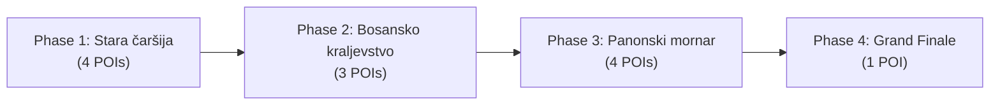
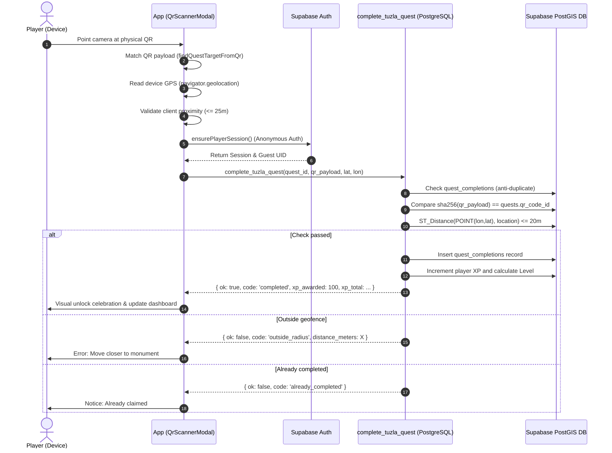

# Tuzla Quest — Game & Verification Manual

**Project:** Tuzla Tour Guide  
**Location:** Tuzla, Bosnia and Herzegovina  
**Architecture:** Snappy Native UI (65% 3D Tactical Map + 35% Tactical Compass HUD) + Illustrated Artistic Map  
**Backend:** Authoritative Supabase PostGIS & Cryptographic QR Verification  
**Total Points of Interest:** 12 Historic Monuments across 4 Gated Phases  

---

## 1. Overview of Tuzla Quest

**Tuzla Quest** is an interactive, location-based city exploration game embedded inside Tuzla Tour Guide. Players navigate through Tuzla's historic core, discovering monuments spanning centuries of history—from medieval Bosnian royalty to modern cultural icons.

The game is designed for fast, snappy, battery-efficient gameplay without clunky camera QRoverlays or vibration interruptions. Players navigate using a tactical compass and an illustrated hand-drawn map, physical QR markers at each location, and real-time GPS proximity validation.

---

## 2. Gameplay Flow & Interface

The Quest interface is divided into two focused sections:

1. **Upper 65% — Interactive 3D Tactical Map (`MapQuestView`)**:
   - Vector 3D buildings and streets powered by MapLibre GL with offline PMTiles vector fallback.
   - Interactive markers color-coded by quest phase.
   - Smooth viewport centering with vertical offset compensation so informational popups open in the middle of the frame without clipping.
   - Shortcut buttons for pedestrian GPS routing, audio narrations, panoramic views, and the Illustrated Map viewer.

2. **Lower 35% — Tactical Compass HUD (`QuestCompassPanel`)**:
   - **Tactical Compass Rose**: Live-rotating cardinal dial (N/E/S/W) driven by device orientation sensors.
   - **Directional Needle**: Points towards the active quest target.
   - **Real-Time Distance Meter**: Dynamic geodesic distance readout in meters or kilometers.
   - **25-Meter Proximity Alert**: When a player approaches within 25 meters of the landmark, the compass dial illuminates in emerald green (`ZONA / IN ZONE`) and the QR scanner CTA pulses.
   - **POI Carousel**: Next/previous buttons and progress pills to review targets in the active phase.

3. **Illustrated Artistic Map (`QuestIllustratedMap`)**:
   - Hand-crafted commemorative artwork (`QuestMap3.webp`, 2000×3558).
   - 12 medallions perfectly aligned with real physical coordinates.
   - Tap any medallion to view phase status, start navigation, or launch the QR scanner directly.

---

## 3. Quest Phases & Points of Interest

The game consists of **12 points of interest** organized into 4 sequentially unlocked phases. A phase is marked complete once all of its locations have been claimed and verified.

### Phase 1 — Foundations of Tuzla / Stara čaršija (4 POIs)

*Focus: The historical heart and founding spaces of Old Town Tuzla.*

1. **Trg slobode (Freedom Square)**
   - **Coordinates:** `44.5395175, 18.6749037`
   - **XP Reward:** 100 XP
   - **Description:** The largest open city square in Bosnia and Herzegovina, centered around the landmark fountain.
2. **Stara česma (Old Town Fountain)**
   - **Coordinates:** `44.5389820, 18.6755800`
   - **XP Reward:** 100 XP
   - **Description:** Historic stone public fountain dating back to the late 19th century.
3. **Kapija Memorial**
   - **Coordinates:** `44.5386300, 18.6768050`
   - **XP Reward:** 100 XP
   - **Description:** Sacred city memorial honoring the youth killed on 25 May 1995.
4. **Meša Selimović & Ismet Mujezinović Monument**
   - **Coordinates:** `44.5370993, 18.6781216`
   - **XP Reward:** 100 XP
   - **Description:** Sculptures commemorating the world-renowned novelist and prominent painter.

### Phase 2 — Bosnian Kingdom & Heritage / Bosansko kraljevstvo (3 POIs)

*Focus: Medieval sovereignty, traditional gastronomy, and salt extraction.*

1. **Tvrtko Park (King Tvrtko I Monument)**
   - **Coordinates:** `44.5380826, 18.6783327`
   - **XP Reward:** 100 XP + King Tvrtko Scratch Card
   - **Description:** Monument of the first King of Bosnia, Tvrtko I Kotromanić.
2. **Palačinkara kod Bagija (Bagi Crêperie)**
   - **Coordinates:** `44.5383762, 18.6775339`
   - **XP Reward:** 100 XP
   - **Description:** Iconic local sweet gastronomy destination in the city pedestrian core.
3. **Soni trg (Salt Square)**
   - **Coordinates:** `44.5382182, 18.6759398`
   - **XP Reward:** 100 XP
   - **Description:** Archaeological museum fountain celebrating over 7,000 years of salt extraction.

### Phase 3 — Lakes, Waterfalls & Art / Panonski mornar (4 POIs)

*Focus: Nature, saline therapy, and artistic expression.*

1. **Panonska jezera (Pannonian Salt Lakes)**
   - **Coordinates:** `44.5390760, 18.6794880`
   - **XP Reward:** 100 XP
   - **Description:** The only salt lakes in Europe located right in the center of a city.
2. **Slani slapovi (Saline Waterfalls)**
   - **Coordinates:** `44.5404243, 18.6819408`
   - **XP Reward:** 100 XP
   - **Description:** Therapeutic cascading saltwater falls within the Pannonica complex.
3. **Slana Banja Park**
    - **Coordinates:** `44.5369610, 18.6879830`
    - **XP Reward:** 100 XP
    - **Description:** Expansive forested park and memorial avenue overlooking Tuzla.
4. **Atelje Ismet Mujezinović**
    - **Coordinates:** `44.5371465, 18.6810454`
    - **XP Reward:** 100 XP
    - **Description:** Preserved studio and gallery of one of Bosnia's greatest visual artists.

### Phase 4 — Grand Finale / Pobjednik Grada soli (1 POI)

*Focus: Modern commercial life and quest culmination.*

 1. **Bingo City Centar (BCC Tuzla)**
    - **Coordinates:** `44.5321770, 18.6517430`
    - **XP Reward:** 100 XP + Grand Finale Master Badge
    - **Description:** Major modern retail, cinema, and gathering hub marking quest completion.

---

## 4. End-to-End Verification Architecture

Verification is entirely cloud-authoritative using Supabase PostGIS. Client-side state changes are never applied until the database confirms successful validation.

### Verification Criteria

1. **Authenticated Session**: The player must have an active session (automatically provisioned as an anonymous guest explorer).
2. **Cryptographic QR Validation**: The server verifies that `sha256(p_qr_payload)` strictly matches `quests.qr_code_id`.
3. **Geodesic PostGIS Distance Check**:
   - The server converts `(p_lat, p_lon)` into a spatial point with SRID 4326.
   - It computes the true spherical distance to the landmark's coordinates.
   - The user must be within the configured **20-meter radius**; otherwise, the server rejects the claim and reports the exact distance excess.
4. **Idempotency & Replay Protection**:
   - Re-scanning an already unlocked POI is rejected with `code: 'already_completed'`.
   - The transaction is atomic: XP, level calculations, and completion timestamps are logged in a single database transaction.

---

## 5. Interactive Rewards & Easter Eggs

- **King Tvrtko Scratch Card**:
  - Scanning the King Tvrtko monument unlocks a digital golden scratch card modal ([TvrtkoScratchCardModal.tsx](file:///f:/TuzlaTourApp/components/TvrtkoScratchCardModal.tsx)).
  - Scratching reveals historical heraldry and navigation instructions to the Stone of Kulin Ban.
- **3D Charter of Kulin Ban Cube**:
  - Reaching coordinates `(44.538791, 18.678778)` automatically activates a rotating 3D historical cube showcasing the Charter of Kulin Ban (1189) with medieval script and modern translations.

---

## 6. Player Dashboard & Progression

The **My Progress** tab ([PlayerDashboard.tsx](file:///f:/TuzlaTourApp/components/PlayerDashboard.tsx)) reflects live server data:

- **Total XP & Level**: Level titles advance from *Explorer* (Level 1) to *Knight of Tuzla* and *Pannonian Master*.
- **Completed Quest Ledger**: Full timestamped ledger of verified scans.
- **Phase Badges**: Visual badges unlock as each phase is conquered.
- **Local Fallback Sync**: In-memory and Preferences state seamlessly reconcile with Supabase records upon dashboard load.
- **Quest completion and reset**: After all 12 locations are verified, the compass panel is replaced by the Bosnia and Herzegovina completion image and scanning is disabled. To restart as a guest, clear the scan history from the dashboard; this clears local quest progress and starts a fresh anonymous session. Previous guest records remain on the server and are not deleted.
